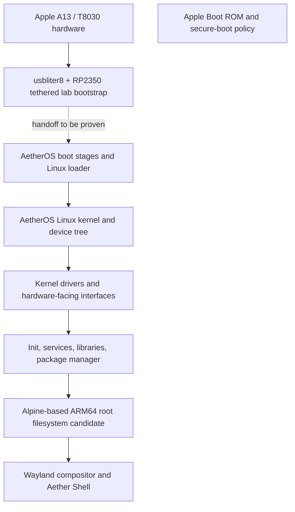

# AetherOS Software Architecture

**Status:** Draft, Phase 0  
**Target:** iPhone 11 / N104AP / Apple A13 (T8030)  
**Last reviewed:** 2026-11-14

## System view



The diagram describes an authorized prototype candidate, not a proven boot chain. It does not imply that iBoot/iBSS or m1n1 have been removed; see the separate independence gate in [BOOTLOADER_RESEARCH.md](BOOTLOADER_RESEARCH.md).

## Layer responsibilities and contracts

| Layer | Owns | Initial contract |
| --- | --- | --- |
| Bootloader | Earliest AetherOS code, CPU handoff preparation, memory map, DTB and Linux Image placement | Enter Linux using the documented arm64 boot protocol only after the actual iPhone execution state and memory are known. No current binary is device-runnable. |
| Linux kernel | ARM64 configuration, T8030 platform support, device tree, required patches and drivers | Expose hardware through established Linux interfaces where possible: DRM/KMS, input, ALSA, power supply, regulator/thermal, MMC/block, networking and standard character devices. |
| Hardware enablement | Device-specific kernel drivers, firmware packaging policy, calibration and board descriptions | Keep hardware-specific behavior behind Linux interfaces; do not duplicate kernel driver responsibilities in a separate userspace HAL. |
| System | PID 1, service lifecycle, logging, package transactions, users, permissions and update coordination | Begin with the smallest useful initramfs and service set; make upgrades and recovery transactional before persistent installation. |
| Distribution | Root filesystem, package selection, image assembly and release metadata | Evaluate Alpine ARM64 and APK for a small first image. Keep package recipes and image generation reproducible. |
| Desktop | Compositor, shell, settings and applications | Wayland compositor with a Qt/QML touch-first shell. A reference compositor may help prototyping; it is not the AetherOS product shell. |

## Boot and kernel boundary

The AArch64 Linux boot protocol requires the loader to prepare RAM and the device tree, place the kernel image, and enter the kernel with defined CPU and register state. Linux expects a DTB address in `x0`, interrupts masked, the MMU off, and cache/coherency conditions satisfied. These generic requirements do not solve T8030 DRAM training, PMGR state, secure-world handoff, or safe device discovery; those remain platform questions.

The kernel source baseline is not yet fixed. Phase 0 will compare the current upstream Linux tree with the A13 work in Cascadia and Hoolock, then record exact revisions and licenses before code is imported. The AetherOS kernel should minimize long-lived divergence and carry only the configuration, device description, and patches required for its supported target.

## Hardware support strategy

Start with the path to a reliable console and shell: boot contract, memory, exceptions, timer/interrupts, SMP, initramfs, and a debug channel. Then bring up storage, touch, wireless, power/thermal, display, audio, and GPU in separate driver-sized steps. A boot-time framebuffer is useful for early output but is not native panel initialization or accelerated graphics.

Where possible, adapt existing open-source Linux drivers instead of reimplementing protocols. Every adaptation needs an upstream URL, pinned revision, license, local patch list, and device-specific validation record. The iPhone 11 panel and GPU must not be inferred from iPhone 11 Pro/OLED results.

## Distribution and desktop decisions

- **Base system:** Alpine Linux is the first candidate because the system is ARM64 and memory-constrained. Confirm package availability, kernel integration, firmware redistribution terms, and update behavior before committing.
- **Init and services:** Start with OpenRC for the first practical rootfs unless a measured bring-up need supports a minimal custom init. Keep PID 1 small and document service dependencies.
- **Package manager:** Use APK while evaluating the distribution. Aether Package Manager is a later compatibility and UX layer, not a prerequisite for the first image.
- **Graphics:** Use DRM/KMS as the kernel/userspace boundary and Wayland for the shell. Native display initialization and GPU acceleration are separate gates.
- **Desktop priority:** Keep the confirmed XFCE/VNC session as a reference and debugging tool. Defer Aether Shell UX and personalization until boot, kernel handoff, image building, persistence, and recovery are demonstrated.

## Repository layout

The initial checkout is a monorepo for coordinated Phase 0 work. Each top-level component has a clear boundary so it can move to a separate repository later without changing ownership.

```text
AetherOS/
├── bootloader/        # stage0, stage1, platform, drivers, kernel-loader
├── kernel/            # config, patches, device-tree, drivers
├── hardware/          # display, touch, audio, wireless, power, storage notes
├── system/            # init, services, package-manager, system-manager
├── desktop/           # compositor, shell, settings, applications
├── distribution/      # rootfs, packages, images
├── tools/             # host-side build and inspection utilities
├── tests/             # future unit, integration and device test plans
└── docs/              # additional design records and lab notes
```

The current stage-0 scaffold is intentionally only cross-compiled to relocatable AArch64 object files. The physical load address, linker map, boot entry ABI, console, and hardware initialization are unproven, so the project does not link a device image yet.

## Development and validation model

- **Apple Silicon host:** Xcode Command Line Tools/Clang for the first freestanding AArch64 compile; add LLVM/LLD, Rust, CMake/Ninja, and containerized kernel builds when their components are introduced.
- **QEMU:** Use for generic ARM64 code and suitable kernel/userspace experiments. QEMU does not model the iPhone 11, A13 PMGR, display, modem, or secure boot behavior.
- **Device lab:** Reserve real-device work for specifically permitted, reversible procedures. Keep boot logs, source revisions, device identity, power/thermal observations, and recovery notes with each experiment.
- **Continuous integration:** Add CI after the first stable local build target and source layout; pin tool versions and build inputs before treating CI output as release evidence.

## Planned phase gates

| Phase | Deliverable | Gate |
| --- | --- | --- |
| 0 — Research and architecture | Four foundation documents and evidence register | Compliant code-execution path documented, or explicit no-go |
| 1 — Development environment | Reproducible cross-build and generic ARM64 smoke target | Clean host build from documented setup |
| 2 — AetherOS execution proof | Minimal AetherOS-owned stage entered through the known lab bootstrap | Entry state, memory map and debug marker repeat across RAM-only boots |
| 3 — Kernel handoff | AetherOS loader starts the Linux kernel with a valid DTB and initramfs | Repeatable AetherOS-owned loader → Linux shell, with serial logs and recovery |
| 4 — Reproducible system image | Buildable ARM64 rootfs, init, essential services and package set | Clean rebuild produces a bootable RAM image with documented inputs |
| 5 — Persistence and recovery | Install/update design and external or device storage evaluation | Backup, rollback and restore demonstrated; internal storage remains gated on a separate decision |
| 6 — Essential hardware enablement | Storage, input, network and power required for a usable system | Each required function independently validated on the device |
| 7 — Aether Shell | Touch-first graphical environment | Boot and recovery milestones are stable; display/input usable without assuming GPU acceleration |
| 8 — GPU research | Accelerated graphics prototype | Kernel and userspace driver path independently demonstrated |
